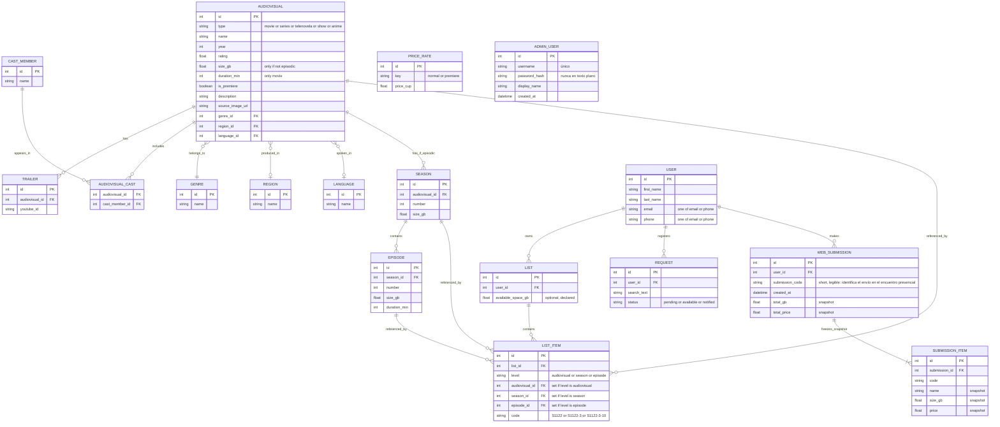
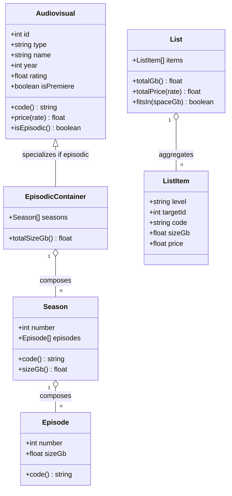
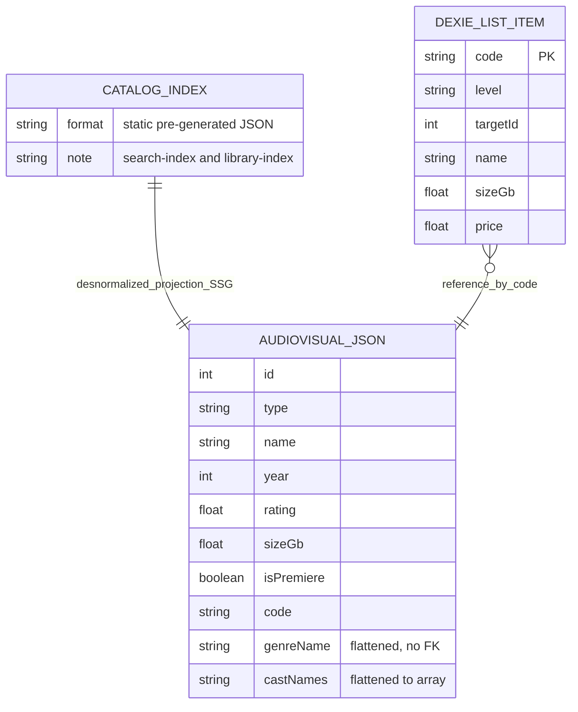

# Daher — Dominio y modelo de datos

> Documento técnico. Describe el dominio del negocio, el modelo entidad-relación del backend y cómo ese modelo se aplana en el cliente.
> Fuente: `documentacion_no_tecnica_de_la_landing_page.md`. Complementa a `daher_arquitectura_frontend.md` (clases de dominio) y `daher_backend.md`.
> Convención: nombres de tablas, entidades y campos en inglés; texto explicativo en español.

**Última actualización:** 2026-06-02

---

## 0. Advertencia de lectura: dos planos distintos

Daher es **SSG con catálogo de solo lectura en el cliente**. Eso parte el modelo de datos en dos planos que NO deben confundirse:

1. **Plano backend / admin** (§3) — base de datos normalizada donde el vendedor escribe el catálogo. Aquí viven las tablas, las FKs y las relaciones N:M. Es el diagrama entidad-relación "de verdad".
2. **Plano cliente** (§5) — lo que llega al navegador. El catálogo se sirve **desnormalizado** como JSON estático. En el cliente solo hay **una** estructura con escritura real: *Mi lista*, en Dexie/IndexedDB.

Mezclar ambos planos es el error clásico. El ERD de tablas describe el backend; el cliente consume una proyección aplanada de ese modelo.

---

## 1. Supuestos de modelado (decisiones tomadas)

1. **Jerarquía episódica en 3 tablas, sin tabla "Series".** El contenedor episódico **es** el propio `AUDIOVISUAL` (su campo `type` dice si es serie, novela, show o anime). No existe una tabla `Series` porque "serie" es solo uno de los tipos episódicos: una novela no es una serie. Las temporadas y capítulos cuelgan de cualquier `AUDIOVISUAL` de tipo episódico. Jerarquía: `AUDIOVISUAL → SEASON → EPISODE`.
2. **El ítem de "Mi lista" referencia el nivel exacto por FK + guarda el código legible.** Lo agregado puede ser un audiovisual completo, una temporada o un capítulo. El ítem apunta al nivel correcto mediante una referencia explícita (`level` + id), y **además** guarda el `code` ya calculado para el vendedor. Ver §3.2.
3. **Cast, Genre, Region y Language como entidades/catálogos propios.** Cast es N:M con el audiovisual; los otros tres son catálogos para que los filtros de Biblioteca (§6.5 funcional) sean consistentes.

---

## 2. Dominios (bounded contexts)

- **Catalog** — el inventario consultable: audiovisuales y la jerarquía episódica, más metadatos (género, reparto, trailers). Corazón de solo-lectura.
- **List** — la selección del usuario ("Mi lista") y sus ítems. Único dominio con escritura intensiva del lado cliente.
- **Account** — usuario, vía de contacto, sesión. Solo para enviar por web y solicitudes.
- **Requests** — pedidos de contenido no disponible (§6.4.3 funcional), asociados a una cuenta.
- **Submission** — el acto de mandar la lista por una de las cuatro vías. Más proceso que datos; persiste solo el envío por web.
- **Pricing** — tarifas configurables (§8 funcional). Tabla de configuración, no hardcode.
- **Admin** — cuentas del operador del panel (`ADMIN_USER`). Aislado del resto; no se relaciona con el catálogo ni con los clientes.

Por qué esta división: cada dominio cambia por razones y a ritmos distintos. El catálogo lo edita el admin a diario; el pricing casi nunca; la lista la cambia el usuario en cada visita. Separarlos evita que un cambio de tarifa toque el catálogo, y deja que el frontend cargue solo lo que cada slice necesita.

---

## 3. Modelo entidad-relación — backend / admin

### 3.1. Por qué cada entidad y relación

- **AUDIOVISUAL** es la entidad raíz del catálogo y, a la vez, el contenedor episódico. `type` distingue película de los cuatro tipos episódicos (series, telenovela, show, anime) sin necesidad de una tabla por tipo. `size_gb` vive aquí solo para no-episódicos; en episódicos el peso real está en season/episode.
- **SEASON y EPISODE** existen porque el usuario puede agregar a la lista cualquiera de los niveles (§6.3.1 funcional), y cada nivel tiene su propio peso y código. Cuelgan de un `AUDIOVISUAL` episódico, sea serie o novela: la jerarquía es la misma para todos los tipos episódicos.
- **TRAILER** es 1:N y opcional (§6.2.3: si no hay, se omite).
- **CAST_MEMBER + AUDIOVISUAL_CAST** es N:M: un actor está en muchos audiovisuales y viceversa. El funcional solo pide nombres (§6.2.4), así que `CAST_MEMBER` es mínimo.
- **GENRE / REGION / LANGUAGE** son catálogos porque son los ejes de filtrado de Biblioteca (§6.5.2). Como catálogo evitan inconsistencias y alimentan los filtros desde la propia tabla.
- **USER** guarda lo mínimo del registro (§4.2): nombre, apellidos y una vía de contacto. La regla "al menos uno de email/phone" se valida en la app.
- **LIST** es del usuario y guarda el `available_space_gb` declarado (§7.3).
- **LIST_ITEM** referencia el nivel exacto (ver §3.2).
- **REQUEST** liga un pedido a la cuenta (§6.4.3), con `status` para que el admin sepa a quién avisar.
- **WEB_SUBMISSION + SUBMISSION_ITEM** son un **snapshot**: al enviar por web se congela qué se pidió y a qué precio. Los datos se copian (no FK al catálogo vivo) porque catálogo y tarifas cambian, y el envío debe reflejar el momento. `submission_code` es un código corto y legible que se le muestra al usuario al enviar y que el vendedor usa para localizar el envío en el encuentro presencial (junto con la búsqueda por nombre/contacto). Ver documento funcional del admin.
- **PRICE_RATE** materializa el pricing configurable (§8.3): se lee de aquí en vez de hardcodear $10/$20.
- **ADMIN_USER** es una tabla **exclusiva del panel admin**, sin relación con el resto del modelo. **No confundir con `USER`**: `USER` es el cliente final que arma listas en la web pública; `ADMIN_USER` es el operador del panel (el vendedor y 2-3 personas de confianza). Son entidades distintas, no comparten FK, y por eso `ADMIN_USER` aparece aislada en el diagrama. No hay roles: toda cuenta de admin tiene los mismos permisos. La primera cuenta se crea en el bootstrap del panel; las demás, desde dentro. `password_hash` se guarda hasheado, nunca en texto plano. Ver documento funcional del admin (§2).

### 3.2. La referencia del ítem de lista

El usuario puede agregar tres niveles distintos: el audiovisual completo (`S1122`), una temporada (`S1122-3`) o capítulos sueltos (`S1122-3-10`). Dos formas de modelar a qué apunta el ítem:

**Opción A — solo el código como referencia.** El ítem guarda `S1122-3-10` y nada más. Funciona para mostrar, pero para saber el peso o validar que existe hay que **parsear el string** (`split('-')`) y luego buscar la fila. El string pasa a ser estructura de datos: frágil, un cambio de formato rompe las consultas y un código mal formado es un dato inválido silencioso.

**Opción B — referencia explícita por nivel + el código como dato (elegida).** El ítem guarda:
- `level` = `audiovisual` | `season` | `episode`,
- el `id` correspondiente a ese nivel (FK real a la tabla correcta),
- y el `code` ya calculado, para el vendedor.

La relación con el catálogo es una FK de verdad (consultas directas, integridad referencial), y el código sigue disponible como etiqueta legible para el encuentro presencial. En el ERD: tres FKs opcionales (`audiovisual_id`, `season_id`, `episode_id`), de las cuales exactamente una está poblada según `level`.

**Por qué no N:M directa:** una relación muchos-a-muchos clásica (list ↔ audiovisual) no alcanza, porque el "otro lado" no es siempre la misma tabla — a veces season, a veces episode. Por eso el ítem lleva el discriminador `level`. Es una relación 1:N desde cada tabla de contenido hacia `LIST_ITEM`, con la regla de que solo una FK aplica por fila.

Formato de código: guiones como separador (`S1122`, `S1122-3`, `S1122-3-10`), consistente con el documento funcional.

---

## 4. Diagrama de dominio (clases)

Cómo se ve el dominio como clases en el frontend (`daher_arquitectura_frontend.md`), independiente de las tablas:

`EpisodicContainer` especializa a `Audiovisual` (no se llama "Series" por la misma razón que la tabla): aplica a series, telenovela, show y anime. `List` y sus métodos (`totalGb`, `fitsIn`) son donde viven las reglas de §7.2–7.3, no en la UI.

---

## 5. Modelo en el cliente

Lo que de verdad existe en el navegador:

### 5.1. Por qué aplanado en el cliente

- El catálogo llega como **JSON pre-generado en build**: género, reparto, etc. ya vienen embebidos como strings/arrays. No hay JOINs en el navegador; las FKs del backend se resuelven en build-time. Sirve a la búsqueda local con MiniSearch y al presupuesto de <50KB del índice.
- **Mi lista en Dexie** guarda lo mínimo para reconstruir el drawer (§7.2) y los totales **sin** depender del catálogo: name, size y price se copian al agregar. Así la lista funciona offline y sobrevive a que un audiovisual cambie o salga del catálogo.
- La relación Dexie↔catálogo es **por código, no FK**: el ítem guarda el `code` y datos-snapshot; no asume que el audiovisual siga existiendo. Mismo principio que `WEB_SUBMISSION` en el backend.

---

## 6. Resumen de decisiones

| Decisión | Elegido | Alternativa descartada | Motivo |
|---|---|---|---|
| Contenedor episódico | El propio AUDIOVISUAL (campo `type`) | Tabla `Series` | "Series" excluye telenovelas/shows; el tipo ya lo cubre |
| Jerarquía | AUDIOVISUAL → SEASON → EPISODE | Tabla autorreferenciada | Jerarquía fija y conocida |
| Referencia del ítem | `level` + FK al nivel exacto, código como dato | Solo el código (parsear string) | FK real consulta sin parsear; código queda como etiqueta legible |
| Cast | Entidad N:M | Texto plano | Reutilización y consistencia |
| Genre/Region/Language | Catálogos | Enum/texto | Alimentan filtros sin inconsistencias |
| Envío y lista persistida | Snapshot (datos copiados) | FK al catálogo vivo | Catálogo y tarifas cambian; el pedido no debe |
| Catálogo en cliente | JSON desnormalizado | Réplica relacional | SSG, búsqueda local, presupuesto de tamaño |
| Identificación en el encuentro | `submission_code` corto + búsqueda por nombre/contacto | Solo nombre | Evita ambigüedad entre usuarios homónimos; el código es inequívoco |
| Cuentas del panel | Tabla `ADMIN_USER` aislada, sin roles | Reusar `USER` con un flag de rol | Cliente y operador son entidades distintas; mezclarlas acopla dos dominios sin relación |